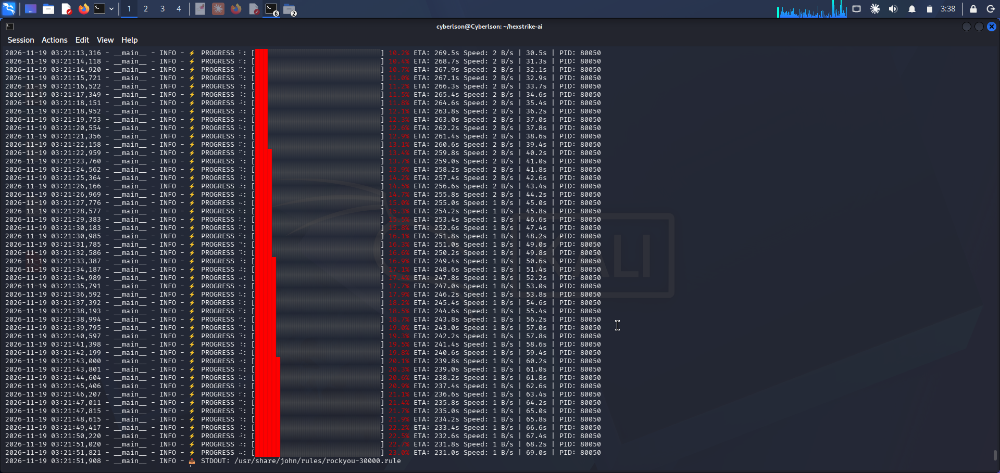
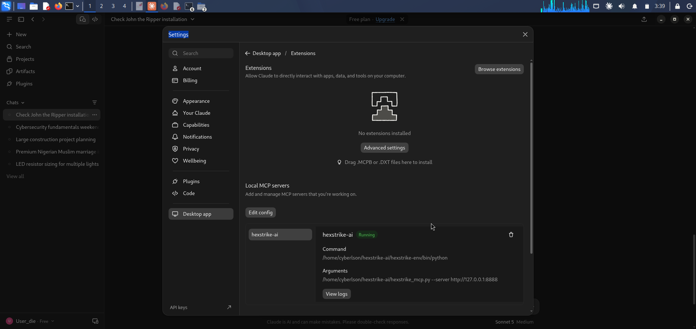
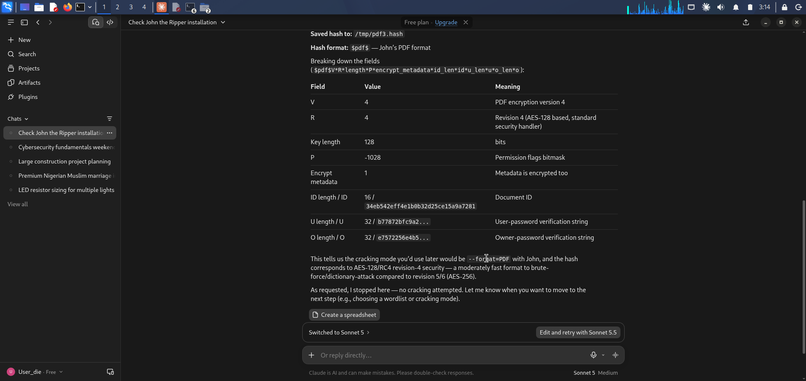
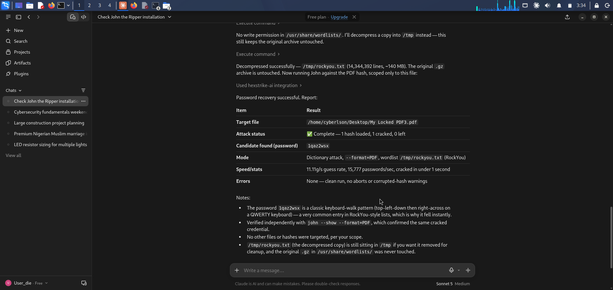
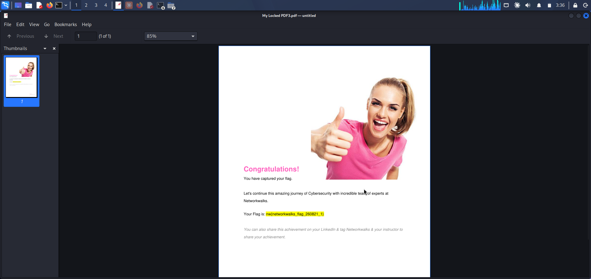

# Week 3 — Optional Project 1: AI-Assisted Password Cracking with HexStrike MCP

**NetworkWalks Cybersecurity Internship | AI-Assisted Security Assessment**

## Overview

This project demonstrates the integration of John the Ripper with Claude Desktop through the HexStrike AI Model Context Protocol (MCP) server for an authorized PDF password-recovery assessment.

The objective was to configure an AI-assisted security testing environment, extract the password hash from an encrypted PDF, conduct a dictionary attack using the RockYou wordlist, and verify the recovered password against the original document.

Having previously used John the Ripper through the Kali Linux command line and Johnny GUI on Windows, I approached this module as an opportunity to integrate an MCP-based AI workflow with established security assessment tools.

The assessment was performed against the encrypted PDF provided for the NetworkWalks internship lab.

## Lab Environment and Tools

| Component | Purpose |
|---|---|
| Kali Linux | Security assessment environment |
| VirtualBox | Virtualization platform |
| Claude Desktop | AI interface for tool orchestration |
| HexStrike AI | Security tooling integration and automation framework |
| Model Context Protocol (MCP) | Communication between Claude and HexStrike |
| John the Ripper Jumbo | Offline password recovery |
| pdf2john | Extraction of PDF password-verification data |
| RockYou | Dictionary used for password candidate testing |
| Python virtual environment | Dependency isolation |

### Verified Environment

- Operating system: Kali Linux
- Python: 3.13.12
- Git: 2.51.0
- John the Ripper: 1.9.0 Jumbo
- John executable: `/usr/sbin/john`
- HexStrike server: `127.0.0.1:8888`
- MCP integration: Connected and running

## Architecture

The assessment used the following local integration:

```text
Cybersecurity Analyst
        |
        v
Claude Desktop
        |
        | Model Context Protocol (MCP)
        v
HexStrike MCP Client
        |
        v
HexStrike AI API Server
(127.0.0.1:8888)
        |
        v
John the Ripper
        |
        v
Encrypted PDF Hash
        |
        v
RockYou Dictionary Attack
        |
        v
Recovered Password
        |
        v
PDF Verification and Flag Capture
```

Claude Desktop provided the natural-language interface, while HexStrike MCP connected the AI environment with the underlying security utilities.

John the Ripper performed the actual password-recovery operation.

## Methodology

### 1. Claude Desktop Installation

Installed a community-maintained Debian-compatible build of Claude Desktop on Kali Linux.

Configured the required package repository and verified that the application launched successfully.

Completed authentication and confirmed the desktop application was operational.

### 2. HexStrike AI Deployment

Cloned the HexStrike AI repository:

```bash
git clone https://github.com/0x4m4/hexstrike-ai.git
cd hexstrike-ai
```

Created an isolated Python environment:

```bash
python3 -m venv hexstrike-env
source hexstrike-env/bin/activate
```

Installed the project dependencies:

```bash
pip install -r requirements.txt
```

Started the HexStrike API server:

```bash
python3 hexstrike_server.py
```

### 3. Localhost Binding and Server Configuration

During the initial startup, the Flask server was listening on all available network interfaces.

To limit exposure within the lab environment, I modified the server configuration to bind specifically to localhost:

```python
app.run(host="127.0.0.1", port=API_PORT, debug=DEBUG_MODE)
```

After restarting, the server confirmed:

```text
Running on http://127.0.0.1:8888
```

This restricted direct access to the Flask API from external network interfaces.

### 4. Claude Desktop MCP Integration

Configured Claude Desktop to communicate with HexStrike through its MCP client.

The following entry was added to the existing Claude Desktop configuration:

```json
{
  "mcpServers": {
    "hexstrike-ai": {
      "command": "/home/cyberlson/hexstrike-ai/hexstrike-env/bin/python",
      "args": [
        "/home/cyberlson/hexstrike-ai/hexstrike_mcp.py",
        "--server",
        "http://127.0.0.1:8888"
      ]
    }
  }
}
```

After restarting Claude Desktop, the Developer settings confirmed that `hexstrike-ai` was running.

**MCP connection status:** Successful.

### 5. John the Ripper Verification

Used Claude through HexStrike MCP to identify the installed John the Ripper executable and version.

**Verified results:**

| Parameter | Result |
|---|---|
| Tool | John the Ripper |
| Version | 1.9.0 Jumbo |
| Executable | `/usr/sbin/john` |
| Package source | Kali Linux |
| Integration | Accessible through HexStrike MCP |

This confirmed that Claude could interact with the underlying password-recovery tooling.

### 6. Encrypted PDF Hash Extraction

Transferred the instructor-provided encrypted PDF from Windows to the Kali Linux virtual machine using a VirtualBox shared folder.

**Target file:**

```text
/home/cyberlson/Desktop/My Locked PDF3.pdf
```

Using Claude and HexStrike MCP, extracted the PDF password hash through the appropriate John the Ripper utility.

The extracted hash was saved to:

```text
/tmp/pdf3.hash
```

**Hash characteristics:**

| Property | Value |
|---|---|
| Format | `$pdf$` |
| Encryption version | V4 |
| Revision | R4 |
| Key length | 128 bits |
| Permissions | -1028 |
| Metadata encryption | Enabled |
| Hash extraction | Successful |

The extracted hash was verified before commencing password recovery.

### 7. Dictionary Attack with John the Ripper

Confirmed that the RockYou wordlist was available as a compressed archive.

Rather than modifying the system wordlist directory, a decompressed copy was prepared in `/tmp`.

**Wordlist details:**

- File: `/tmp/rockyou.txt`
- Candidates: 14,344,392
- Approximate size: 140 MB
- Original compressed archive: Preserved

The assessment used John the Ripper's PDF format with the RockYou wordlist.

Equivalent John the Ripper command:

```bash
john --format=PDF \
  --wordlist=/tmp/rockyou.txt \
  /tmp/pdf3.hash
```

The operation was performed through Claude and HexStrike MCP, limited to the authorized internship PDF.

### 8. Password Recovery Results

The dictionary attack successfully recovered the password.

| Metric | Result |
|---|---|
| Attack | Dictionary-based password recovery |
| Password hash | PDF |
| Hashes loaded | 1 |
| Hashes cracked | 1 |
| Remaining hashes | 0 |
| Recovered password | `1qaz2wsx` |
| Reported candidate testing rate | 15,777 passwords/sec |
| Reported recovery time | Under 1 second |
| Errors | None |

The result was independently checked using:

```bash
john --show --format=PDF /tmp/pdf3.hash
```

John confirmed the recovered credential.

### 9. Password Verification and Flag Capture

Opened the original encrypted PDF and supplied the recovered password:

`1qaz2wsx`

The document opened successfully, displaying the NetworkWalks completion message and verification flag.

**Captured flag:**

```text
nw{networkwalks_flag_260821_1}
```

This confirmed the successful completion of the authorized password-recovery lab.

## Evidence and Screenshots

### Screenshot 1 — HexStrike MCP Integration



*Figure 1: Claude Desktop showing the HexStrike MCP server running.*

### Screenshot 2 — John the Ripper Verification



*Figure 2: John the Ripper executable and version verified through the MCP integration.*

### Screenshot 3 — PDF Hash Extraction



*Figure 3: Successful extraction and analysis of the encrypted PDF hash.*

### Screenshot 4 — Password Recovery



*Figure 4: AI-assisted dictionary attack showing successful password recovery.*

### Screenshot 5 — Flag Verification



*Figure 5: Protected PDF successfully opened and NetworkWalks verification flag captured.*

## GitHub Project Structure

```text
Optional1-HexStrike-AI-JTR/
├── README.md
└── screenshots/
    ├── W3-Optional1-HexStrike-MCP-Running.png
    ├── W3-Optional1-JTR-Verification.png
    ├── W3-Optional1-PDF-Hash-Extracted.png
    ├── W3-Optional1-JTR-Password-Cracked.png
    └── W3-Optional1-PDF-Flag-Captured.png
```

## Technical Findings

### 1. Predictable Password Patterns

The recovered password, `1qaz2wsx`, follows a recognizable keyboard-walk pattern.

Although it contains a combination of letters and numbers, its predictable structure makes it susceptible to dictionary-based attacks.

This reinforces the importance of password unpredictability rather than character variety alone.

### 2. Offline Password Recovery

Once the encrypted PDF's password-verification data was extracted, John the Ripper could test candidates locally without repeated interaction with the original document.

The exercise demonstrates how offline password recovery can expose weak credentials.

### 3. AI-Assisted Tool Orchestration

Claude Desktop, through HexStrike MCP, coordinated the assessment workflow, including tool verification, hash extraction, wordlist preparation and password recovery.

The underlying security tools performed the technical operations, while the MCP integration provided an interface for initiating and reviewing those operations.

### 4. Local Security Controls

Restricting the HexStrike API server to `127.0.0.1` reduced unintended network exposure.

Because the framework can execute security tools, controlling access to the MCP integration and reviewing requested operations remain important.

### 5. Evidence-Based Validation

The password-recovery result was verified through John the Ripper and by opening the original encrypted PDF.

The retrieved flag provided additional evidence that the intended training objective had been achieved.

## Security Recommendations

- Use long, randomly generated passwords or strong passphrases.
- Avoid keyboard patterns, common dictionary entries and reused passwords.
- Prefer current encryption standards for sensitive documents.
- Restrict exposure of encrypted files and password-verification material.
- Keep AI-connected security tooling limited to authorized environments.
- Review tool permissions and retain evidence of testing activities.
- Avoid exposing MCP servers or administrative APIs unnecessarily.

## Conclusion

Successfully configured and tested an AI-assisted password-security assessment environment using Claude Desktop, HexStrike MCP and John the Ripper on Kali Linux.

The project involved deploying a local MCP integration, securing the API listening interface, extracting PDF password-verification data, conducting a RockYou dictionary attack, verifying the recovered password and capturing the required NetworkWalks flag.

This assessment extended my existing experience with John the Ripper by incorporating AI-driven tool orchestration into a controlled cybersecurity lab.

All testing was restricted to the authorized internship materials.

---

**Program:** NetworkWalks Cybersecurity Internship  
**Module:** Week 3 — Optional Project 1  
**Category:** AI-Assisted Ethical Hacking / Password Security Assessment  
**Environment:** Kali Linux / VirtualBox  
**Tools:** Claude Desktop, HexStrike MCP, John the Ripper  
**Status:** Completed