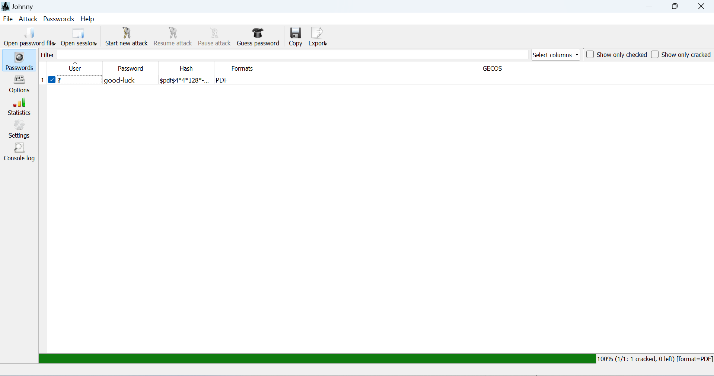

# Week 3 — PM1: Password Cracking with John the Ripper

**NetworkWalks Cybersecurity Internship | Password Security Assessment**

## Overview

This project focuses on offline password recovery and hash analysis using John the Ripper (JTR). The objective was to recover the password of an encrypted PDF provided as part of the NetworkWalks cybersecurity practical assessment and validate the result by accessing the protected document.

I have previously worked with John the Ripper through the Kali Linux command-line interface. For this exercise, I used **Johnny GUI on Windows**, following the lab's required workflow while applying the same underlying password-cracking techniques.

## Tools and Environment

| Tool | Purpose |
|---|---|
| John the Ripper (JTR) | Offline password recovery |
| Johnny GUI 2.2 | Graphical interface for JTR |
| Windows | Lab operating environment |
| PDF Hash Extractor | Extraction of the encrypted PDF's password hash |
| Adobe Acrobat Reader | Verification of the recovered password |

## Methodology

### 1. Environment Configuration

Installed John the Ripper and Johnny GUI on Windows, then configured Johnny to use the John executable.

### 2. Hash Extraction

Extracted the password hash from the provided encrypted PDF and saved it in `hash1.txt`.

The extracted hash was identified as a PDF password hash and prepared for processing with John the Ripper.

### 3. Offline Password Recovery

Imported `hash1.txt` into Johnny GUI and executed the password-recovery attack using John the Ripper.

The tool successfully recovered the password associated with the encrypted document.

**Recovered password:**

`good-luck`

**Result:** 1 of 1 hashes cracked successfully (100%).

### 4. Password Verification

Used the recovered password to open the original encrypted PDF in Adobe Acrobat Reader.

The document opened successfully, confirming the validity of the recovered password.

### 5. Flag Capture

After accessing the protected PDF, I retrieved the NetworkWalks verification flag:

`nw{cybersecurity_flag_captured_2608}`

This confirmed successful completion of the practical challenge.

## Evidence

### Password Recovery — Johnny GUI



*Figure 1: Successful PDF password recovery using John the Ripper through Johnny GUI.*

### Flag Verification — Protected PDF


*Figure 2: Successfully opened the encrypted PDF and retrieved the verification flag.*

## Project Structure

```text
PM1-John-the-Ripper/
├── README.md
├── hash1.txt
└── screenshots/
    ├── W3-PM1-Johnny-Password-Cracked.png
    └── W3-PM1-PDF-Flag-Captured.png
```

## Technical Observations

- John the Ripper can perform offline password recovery using extracted authentication material without repeatedly interacting with the original protected document.
- Johnny GUI provides a graphical workflow for the John the Ripper engine, while its underlying password-recovery functionality remains consistent with command-line usage.
- Password complexity, candidate selection and attack configuration directly affect the feasibility and performance of password recovery.
- Successful hash recovery should be followed by verification against the original encrypted file.
- Password-protected documents remain vulnerable to offline guessing when weak or predictable passwords are used.

## Security Recommendations

- Use long, unique passwords for sensitive documents.
- Prefer randomly generated passwords or strong passphrases.
- Use modern encryption configurations supported by the document format.
- Avoid predictable password patterns and commonly used credentials.
- Protect encrypted documents against unauthorized access and disclosure.

## Conclusion

Successfully recovered the password of the provided encrypted PDF using John the Ripper through Johnny GUI on Windows, verified access to the document and captured the required flag.

The exercise demonstrated the practical application of offline password recovery, PDF hash analysis and password-strength assessment within an authorized cybersecurity training environment.

---

**Project:** NetworkWalks Cybersecurity Internship  
**Module:** Week 3 — PM1  
**Category:** Ethical Hacking / Password Security Assessment  
**Status:** Completed